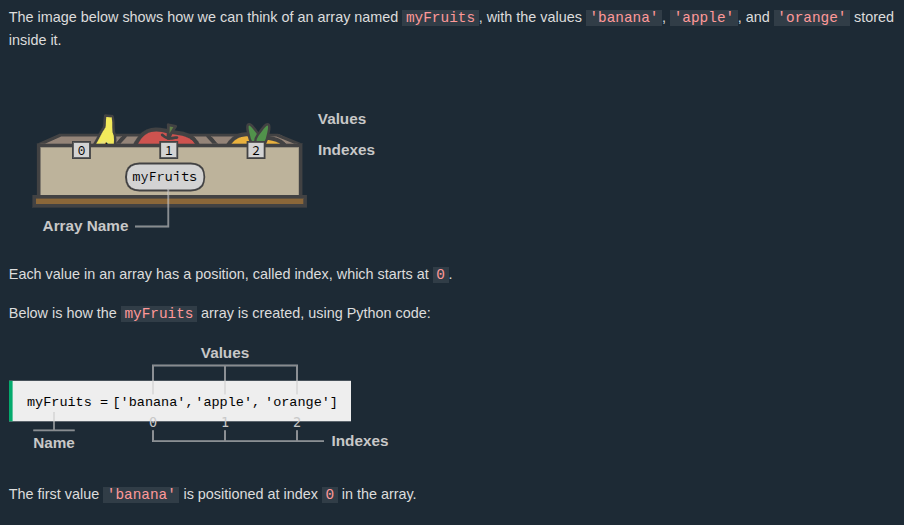

# ARRAYS IN PROGRAMMING

Arrays are made for storing many values together.

## What is an Array?

An array is a collection of values that are stored.


## What Can I Do With an Array and How to Create an Array?

so instead of creating three variables for fruit category:

```py
fruit_1 = 'banana'
fruit_2 = 'apple'
fruit_3 = 'orange'
```

Declare an Array:

```py
myFruits = ['banana', 'apple', 'orange']
```

## How to Read an Array Value?

```py
myFruits = ['banana', 'apple', 'orange']
print(myFruits[0])
```

## Updating an Array Value

```py
myFruits = ['banana', 'apple',  'orange']
myFruits[0] = 'kiwi' # swapping banana with kiwi or you can say replacing banana with kiwi
print(myFruits[0])
```

## Inserting an Array Value

```py
myFruits = ['banana', 'apple', 'orange']
myFruits.append('kiwi')
print(myFruits)
```
A value can also be added to a specific position in an array, using the index, like this:

```py
myFruits = ['banana', 'apple', 'orange']
myFruies.insert(1, 'kiwi')
print(myFruits)
```
## Remove an Array Value
An array is removed by specifying the position in integer.

```py
myFruits = ['banana', 'apple', 'orange'] # apple would be removed
myFruits.pop(1)
print(myFruits)
```

A value can also be removed from the end of an array, without using the index (except for Java), like this:

```py
myFruits = ['banana', 'apple', 'orange'] # orange would be removed
myFruits.pop()
print(myFruits)
```
## Finding The Length of an Array

```py
myFruits = ['banana', 'apple', 'orange'] # in Length it's 3
print(len(myFruits))
```

## Looping Through an Array

Looping through an array means to look at every value in the array.

```py
myFruits = ['banana', 'apple', 'orange']

for fruits in myFruits:
    print(fruits)
```

Another way to loop through an array is to use a for loop with a counting variable for the indexes, like this:

```py
myFruits = ['banana','apple', 'orange']

for i in range(len(myFruits)):
    print(myFruits[i])
```

Other things we can do with looping through arrays is to find out if "Charles" appears in an array of names, or we can loop through an array of groceries for example, to find the total sum we need to pay for them.

Below is an example of looping through an array of names, looking for "Charles".

```py
listOfName = ['Love', 'Esther', 'Charles', 'Chibueze', 'Bob']

for i in range(len(listOfName)):
    print(listOfName[i])
    if listOfName[i] == 'Charles':
        print('Found Charles!')
        break
```
In the code above, the break statement stops the loop once "Charles" is found. That is why "Bob" is not printed.
