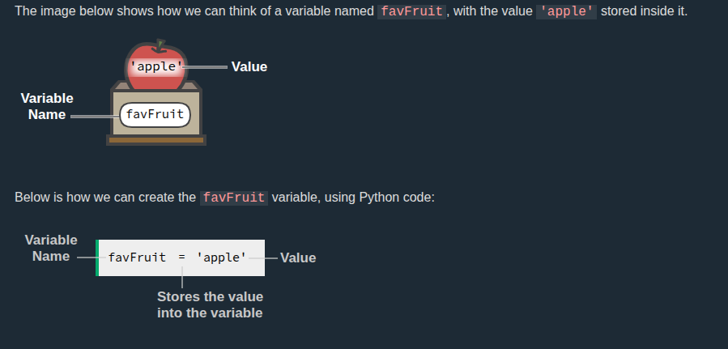

# VARIABLES IN PROGRAMMING

Variables in programming are used to store values.

## What is Variables?
Variables is has a name and you can store data in it.


The code above declares a variable named `favFruit` and the `=` is used to store the value `'apple'` inside the variable.

## Declaring a Variable

Below is how you declare a variable in Python and Go:

Python
```py
favFood = 'noodles'
```

Go
```go
var favFood = "noodles" 
```

## Add Variable to A string

Python
```py
favFood = 'noodles'
print("My favorite food is " + favFood)
```

Go
```go
var favFood = "noodles"
fmt.Print("My favorite food is " + favFood)
```

## Add Two String Variable Together

Python
```py
firstName = 'Chibueze'
lastName = 'Maxwell'
print(firstName + lastName)
```

Go
```go
var firstName = "Chibueze"
var lastName = "Maxwell"
fmt.Print(firstName + lastName)
```

## Add Two Number Variables

Python
```py
a = 1
b = 2
print(a + b)
```
Go
```go
var a = 5
var b = 2
fmt.Print(a + b)
```

Note you can do this in other mathematical operations like the signs are:

Division: `/`
Addition: `+`
Multiplication: `*`
Subtraction: `-`

## Incrementing a Variable

Python
```py
a = 2
a += 1
print(a)
```

## Decrementing a Variable

Python
```py
a = 6
a -= 2
print(a)
```

## Using Variable in an if Statement

Python
```py
temp = 25
print('Temprature: ' + str(temp) + '�C')

if temp > 20:
    print('It is warm')
else:
    print('It is not warm')
```

## The Variable Name
1. A variable name cannot contain spaces.
2. A variable name cannot start with a number.
3. A variable name cannot be a reserved word like if, else, for, function

For readability, it is common to use **camelCase** or **snake_case** when naming variables, so instead of `myfavanimal`, we can use `myFavAnimal` or `my_fav_animal`.
