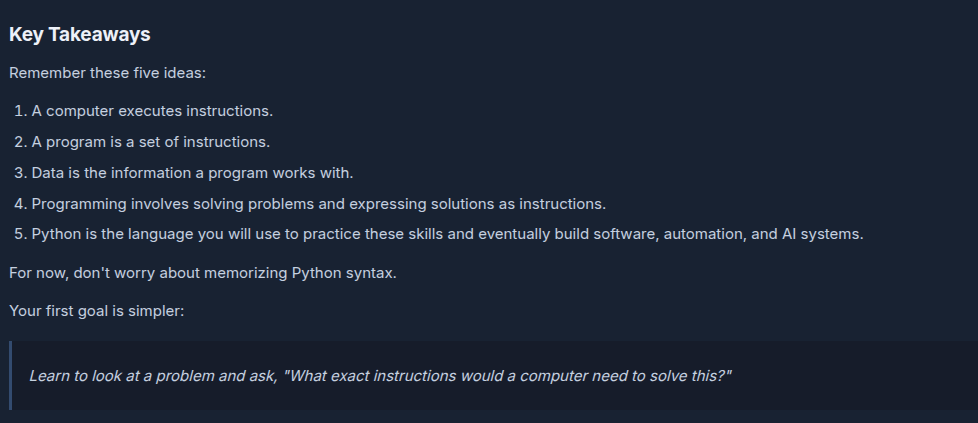

A computer executes intructions that are provided to it.

Programming is basically giving a computer instruction to follow to process and give an output based on the instructions that solve a problem.

Python is simply a tool and a programming language.

When i encounter a new programming concept i should be able to handle it by:
1. what is the problem?                            |       what are we trying to accomplish?
2. What data do we have?                           |       what information does the program need?
3. What instructions are required?                 |       What steps transform that data into the desired result?
4. How do we express those instructions?           |       What Python code represent the solution?

As a programmer whatever colleciton of code i write that other programmers can read is a source code.

Skills i have as a programmer?
1. Writing clean and efficient code.
2. Problem solving.
3. Testing applications.
4. Fixing errors("bugs") in the code.
5. Ability to work well within a team.
6. Patience and perseverancel.

It is my job to take the needs of a client to produce a working application or solution.

Programmers make use of flowcharts to plan and represent their logic.

Flowcharts are diagrams that use different shapes to represent different types of actions or steps in a process.

How programming works?
1. Clearly define the problem you want to solve and what you want the program to do.
2. Think logically and break the problem down into smaller, more manageable steps.
3. Draw a flowchart to map out the steps and logic of your program. use [excalidraw](https://excalidraw.com/) to draw it.
4. Write the program code in the chosen programming language.
5. Test the program thoroughly to ensure it works correctly.
6. Debug and fix any errors or issues that are found.
7. Maintain and update the program as needed.

Leaning to code offers numerous benefits, both personal and professional:
1. Develop critical thinking and problem-solving skills.
2. Boost your creativity and innovation.
3. Improve your communication and collaboration skills.
4. Open up a world of career opportunities.
5. Make a tangible impact on the world around you.
6. Gain a sense of accomplishment and confidence as you see your ideas come to life.
7. Gain a deeper understanding of how technology works.

[CS50 - Computaional Thinking](https://www.youtube.com/watch?v=jjqgP9dpD1k)

computer use binary zero and one '0 & 1'.
bit mean binary digits (0 & 1).
byte is just a term describing 8 bits.
kilobyte 1,000 bytes
megabyte 1,000 kilobytes
gigabyte 1,000 megabytes
terabyte 1,000 gigabytes

Algorithm in the context of problem solving is a step by step process for solving a problem.

Pseudo code is code-like syntax that you write in english or your own spoken language that represents your ideas but in a succinct way.

Hardware is the physical, tangible components of a computer system. It is what you can touch.

Software is not a physical object you can hold. Software is a set of instructions that tell the hardware what to do.