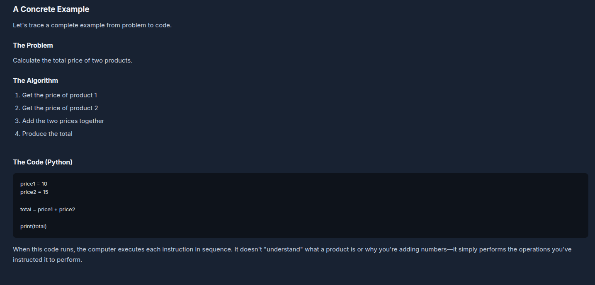
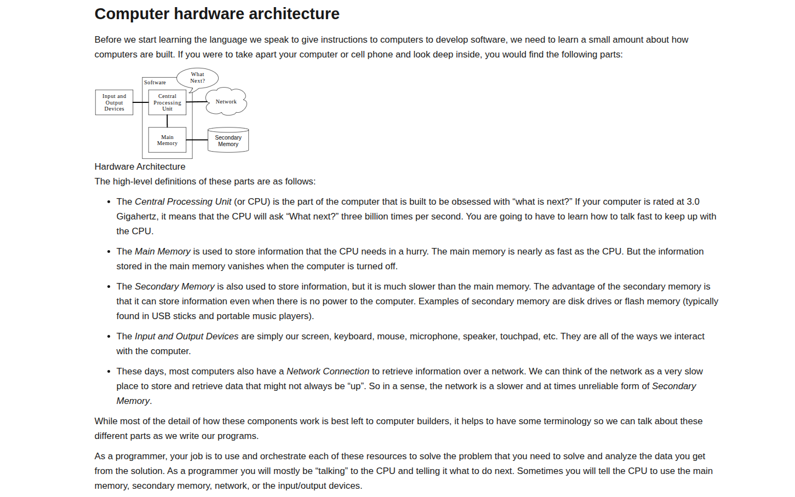
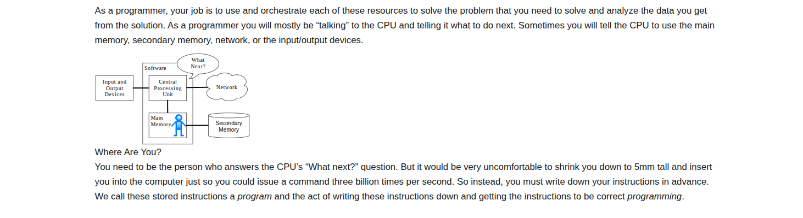
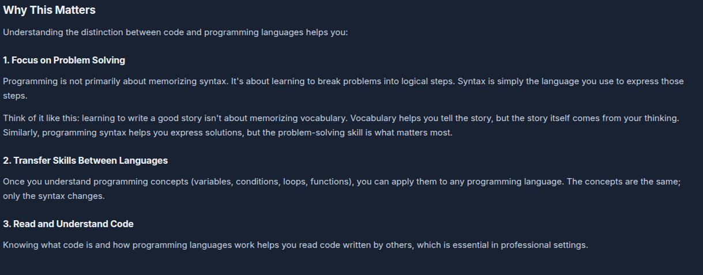

# Programming

This is the process of creating instructions that tell a computer how to perform a task.

Programming solves a problem by:
1. Understanding the problem
2. Figuring out a sequence of steps that will solve it
3. Expressing those steps in a language the computer can execute.

Programming is not primarily about memorizing syntax or typing code. Those are mechanical skills. The real skill is learning to break problems down into instructions a computer can folleow.

## Mental Model: Problem -> Algorithm -> Code

### The Problem:

What needs to be accomplished? This is the real-world situation you're addressing.

### The Algorithm:

A sequence of steps that solves the problem. This is language-agnostic. you can write it in plain English, pseudocode, or flowcharts.

### The Code:

The algorithm written in a specific programming language. This is the set of instructions the computer can execute.

## What Programming is Not

Programming is not "typing code."

A programmer spends a significant amount of time:

- Understanding what problem they're solving
- Asking questions to clarify requirements
- Thinking about what could go wrong
- Designing a solution before writing a single line
- Testing and debugging
- Reading and understanding existing code 

Typing is the easy part. The thinking is the work.

The very fact that computers are good at things that humans are not is why you need to become skilled at talking "computer language".

Python is a high-level language intended to be relatively straightforward for humands to read and write and for computers to read and process.

An interpreter reads the source code of the program as written by the programmer, parses the sourde code, and interprets the instructions on the fly. Python is an interpreter.

Compiler is a tool that translate the source code of a program into machine code that can be executed by the computer.

**Debugging** is the process of finding the cause of the error in your code. When you are debugging a program, and especially if you are working on a hard bug, there are four things to try:

##### reading:

Examine your code, read it back to yourself, and check that it says what you meant to say.

##### running:

Experiment by making changes and running different versions. Often if you display the right thing at the right place in the program, the problem becomes obvious, but sometimes you have to spend some time to build scaffolding.

##### ruminating:

Take some time to think! What kind of error is it: syntax, runtime, semantic? What information can you get from the error messages, or from the output of the program? What kind of error could cause the problem you're seeing ? What did you change last, the problem appeared?

##### retreating:

At some point, the best thing to do is back off, undoing recent changes, until you get back to a program that works and that you understand. Then you cna start rebuilding.

The process of translating from a high-level language to a lower-level language is called "transpiling", whichis a subset of "compiling".

High level languages get transpiled into lower level languages

Lower level languages get compiled into assembly language

Assembly language get compiled into machine code

Machine code tells the hardware where to allocate and direct power

The hardware uses combinations of bits operate the power in order to run the programs and applications what we want it to.

### What is code?

A set of instructions writen in a programming language that tells a computer what to do.

### What is a programming language?

A system of rules and symbols that allows humans to write instructions that computers can execute.

A true programmer is someone who has learnt to think systematically.

Python is a language and a toolbox combined. It has several standard libraries that provide various functionalities that can be used to solve different problems. These libraries are pre-written pieces of code that can be imported and used in your program. 

Here are some examples of standard libraries in Python:

**Collections:**
- **Counter**: A dictionary subclass for counting hashable objects.
- **deque**: A double-ended queue, which is a list that allows efficient appends and pops from both ends.
- **OrderedDict**: A dictionary subclass that remembers the order in which items were inserted.

**Math:**
- **math**: Mathematical functions such as trigonometric functions, logarithms, etc.
- **random**: Functions for generating random numbers.

**Time:**
- **time**: Functions for working with time, such as sleeping, measuring time, etc.
- **datetime**: Classes for working with dates and times.

**OS:**
- **os**: Functions for interacting with the operating system, such as file operations, environment variables, etc.

**Sys:**
- **sys**: Functions for interacting with the Python interpreter, such as command-line arguments, standard input/output, etc.

**String:**
- **string**: Useful string constants and classes.

**JSON:**
- **json**: Functions for working with JSON data.

Python is a high-level, general-purpose programming language that allows us to give instructions to computers.

Computer is a programmable electronic system that receives, processes, and produces results.

### What is Data?
Date is ingormation represented in a form a computer can store, move, and process.
It is the raw facts and values a computer can store and work with, such as names, numbers, dates, and prices. On its own, a piece of data has no meaning. When program organises it and gives it context, it becomes information.

**Example:**

5000 is just data. 5000 is 20% off 6,250 is information.

Computers need a digital representaion for everything they store.

